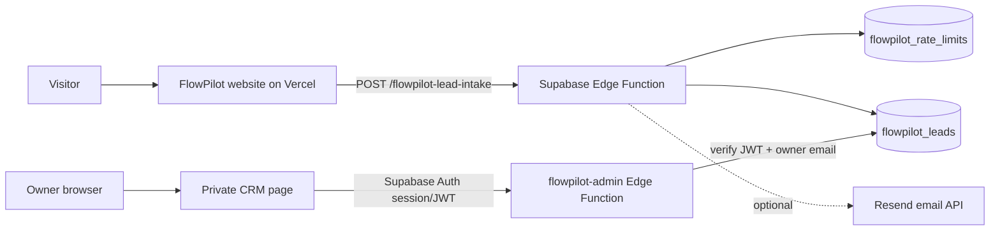

# FlowPilot Automation

**Lead intake, qualification and CRM workflows for service businesses.**

FlowPilot is a lightweight lead operations platform designed to help small agencies capture enquiries, qualify opportunities consistently, and manage follow-up from a private owner workspace.

> **Project status:** Website and Supabase Edge Functions are deployed. Authentication and end-to-end lead submission still require owner setup and live verification. This repository documents the current system and its operational boundaries; it does not claim unverified capabilities.

## Live links

- Website: https://flowpilot-europe-automation.vercel.app/
- CRM: https://flowpilot-europe-automation.vercel.app/admin.html
- Blog: https://flowpilot-europe-automation.vercel.app/blog/
- Supabase project: https://supabase.com/dashboard/project/ahlhyzmjoiqqqmdopffb

## Capabilities

- Public enquiry intake through a Supabase Edge Function.
- Server-side field validation, consent check, honeypot and basic rate limiting.
- Lead scoring and tier assignment.
- Private owner CRM endpoint protected by Supabase JWT verification and an owner-email allowlist.
- Lead status and internal-note updates.
- Optional email notification integration through Resend secrets.
- Responsive public site, blog articles, SEO metadata, sitemap and robots rules.

## Architecture

See [architecture](docs/architecture.md), [API reference](docs/api.md), [database schema](docs/database.md), [security](docs/security.md), and [deployment](docs/deployment.md).

## Technology

- Static frontend served by Vercel
- Supabase Postgres and Edge Functions
- Supabase Auth for owner identity and JWT sessions
- Optional Resend for owner notifications
- GitHub Actions for repository checks

## Local development

The deployed static site is currently hosted on Vercel. To work on the frontend, clone this repository and inspect the `src/` deployment files once they are added to source control. Do not commit credentials or production data.

For local API testing, use the documented endpoints and synthetic data only. Never use real prospect data for tests.

## Configuration

The frontend uses a Supabase publishable key, which is designed for public clients. The following must remain server-side Supabase Edge Function secrets:

- `SUPABASE_SERVICE_ROLE_KEY`
- `FLOWPILOT_OWNER_EMAIL`
- `RESEND_API_KEY`
- `RESEND_FROM_EMAIL`

Do not commit `.env` files, service-role keys, access tokens, passwords, or real lead exports.

## Current verified state (2026-11-05)

- Supabase project `flowpilot-lead-management`: `ACTIVE_HEALTHY`, region `eu-central-1`.
- `flowpilot-lead-intake`: active, version 3, JWT verification disabled by design because it is a public intake endpoint with application-level validation.
- `flowpilot-admin`: active, version 1, JWT verification enabled and owner-email authorization implemented.
- RLS is enabled on both public tables.
- At last audit, owner Auth user count = 0, lead count = 0, and rate-limit row count = 0.
- No successful browser-to-database form submission or CRM login has yet been demonstrated.
- Resend secrets are not configured.
- Privacy page remains a draft and requires legal review before collecting EU personal data at production scale.

These are point-in-time observations, not guarantees of current service availability.

## Roadmap

- [ ] Create and confirm the authorized owner account in Supabase Auth.
- [ ] Verify CRM login and owner-only access with positive and negative tests.
- [ ] Submit a synthetic enquiry and verify database persistence.
- [ ] Harden input parsing, CORS behaviour, rate-limit retention and pagination.
- [ ] Complete privacy notice, retention policy and lawful-basis review.
- [ ] Configure verified email sender and notification secrets if needed.
- [ ] Add CI checks and browser-level end-to-end tests.
- [ ] Capture current deployment and test evidence.

## Contributing

See [CONTRIBUTING.md](CONTRIBUTING.md). Security concerns should be reported privately; see [SECURITY.md](SECURITY.md).

## License

MIT. See [LICENSE](LICENSE).
